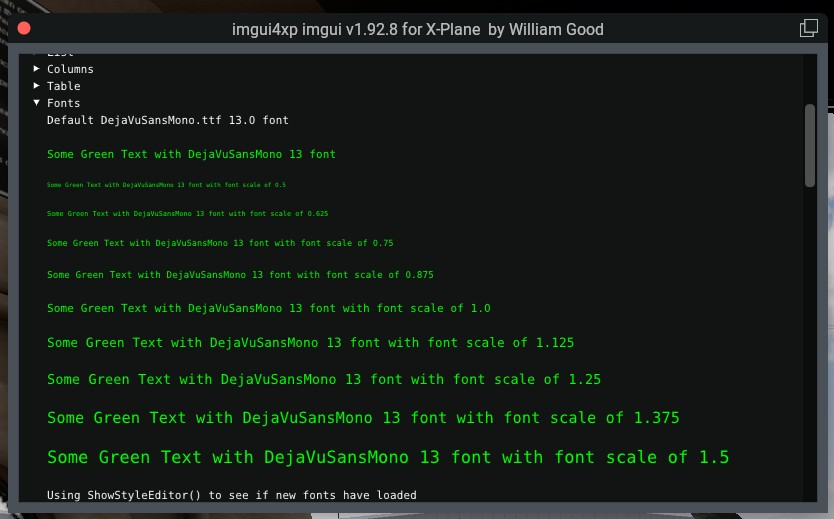

# imgui4xp

Imgui Template For X-Plane 12 Also Showing How To Support Multi Platform From Linux

I am documenting the process I took to get a multiplatform stand alone plugin that supports imgui on X-Plane built on Ubuntu 22.04 LTS. My goal it to make it easier for the next developer to accomplish the same task. With this template you should be able to develop an idea on FlyWithLua NG using its new support for imgui and when developed far enough then convert it to a stand alone plugin with no need for lua. I hope someone will find this useful.  

Thanks to kuroneko on x-plane.org and his repository at https://github.com/xsquawkbox/xsb_public we have added the ability to select the font you want to use and also use the ImGui::SetWindowFontScale(1.00) function to set the size you want your fonts to be. You first pick the font you want for the project then using the ImGui::SetWindowFontScale(1.00) function you can change the size of the font on any line you chose. Now we when using imgui 1.92.8+ we can load in more than one font and they are scalable. 

First clone imgui4xp using this command "git clone --recurse-submodules https://github.com/sparker256/imgui4xp.git" and put the resulting imgui4xp folder wherever you like. I normally put myself in the folder where I want the repository folder to reside first.

> [!NOTE]
> If you already cloned without `--recurse-submodules` and find that
>
> `src/ImgWindow` is _empty_, just run: `git submodule update --init --recursive`

## Multi Platform Build from Linux

Since I develop on Linux my IDE of choice is QT Creator which is installed from my package manager.

I have scripts and make files that allow me to click on one button on my desktop and automatically build for all three platforms.

You will need a compiler to build the Linux files and the following command will get that for you.

`sudo apt-get install build-essential`

To build for Windows on Ubuntu you will need to use this command:

`sudo apt-get install mingw-w64`

To build the Mac files on Ubuntu you need to go to the osxcross GitHub site found here.

https://github.com/tpoechtrager/osxcross

And follow there instructions and then you will need to install the clang compiler using this command.

`sudo apt-get install clang-3.8`

With all this correctly installed you to should be able to build for all three platforms on Ubuntu using Cmake.

## Multi Platform Build using Docker

I have now also added the ability of using Docker to build for all three platforms.
Find more information in `docker/README.md`.

## Windows: Visual Studio

On Windows, you can use
[Visual Studio's "Open Folder" feature](https://docs.microsoft.com/en-us/cpp/build/open-folder-projects-cpp)
to open the project's `src` folder and build the plugin based on its CMake configuration.

Results will be in `src/build-win`.

## Mac OS: Xcode

An Xcode project is provided as `imgui4xp.xcodeproj`.

You may want to change the value of the user-defined build macro
`XPLANE11_ROOT` in the build settings to point to your X-Plane 11
installation. Then the resulting binary is installed there right away.

## ImGee 1.0.0 Modern Cockpit Suite (`ImgWindow/contrib/`)

This release bundles **ImGee 1.0.0**, an enterprise-grade cockpit UX and styling suite built into `src/ImgWindow/contrib/` and accessible in any C++ source file via:
```cpp
#include "ImgWindow/contrib.h"
```

### Features at a Glance:
* **Avionics Controls:** Rotary dimmer dials, korry split-lens pushbuttons, rocker switches, mouse-wheel sliders with 1-click restore.
* **CommonMark Engine:** Real-time markdown with procedural vector icons, `<pill>`, `<badge>`, `<kbd>`, `<style>`, `<backdrop>`, and auto-formatted tables.
* **Canonical `ImGui::MD::Button`:** 1:1 drop-in replacement for `ImGui::Button()` with rich markdown button faces and standalone styled pill buttons.
* **Stationary Tooltips:** Zero-jitter `TimedTooltip::MD::Text` with dwell timers.
* **Live Cockpit Showcase:** Launch `"ImGee Cockpit Showcase"` from the X-Plane Plugins menu to explore all controls, live markdown scratchpad, and the interactive theme picker.

For architectural documentation, see [`docs/ImGee_Architecture_and_Transcript_2026-10-26.md`](docs/ImGee_Architecture_and_Transcript_2026-10-26.md).  
For distribution guidelines and details on X-Plane updater systems (such as SkunkCrafts Updater), see [`docs/Distribution_and_Updaters.md`](docs/Distribution_and_Updaters.md).

## Imgui4xp


